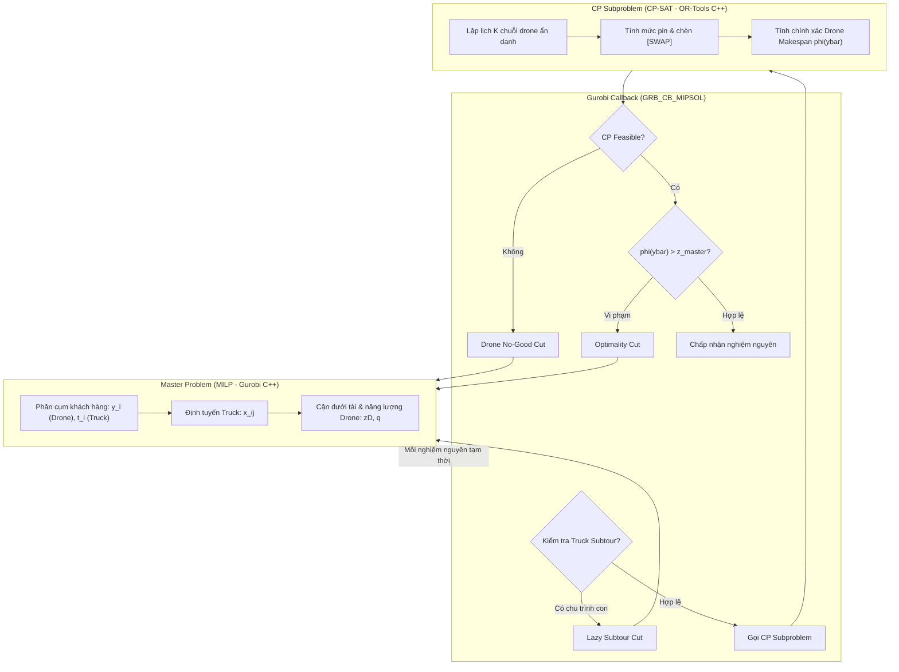

# Ghi Chú Kỹ Thuật: Dự Án MILP Master + CP Subproblem (PDSTSP with Battery Swap)

Tài liệu này tổng hợp toàn bộ kiến trúc hệ thống, mô hình toán học, phân tích điểm nghẽn của các vết cắt hiện tại và đề xuất chi tiết các công thức toán học/mã nguồn cải tiến cho **No-Good Cut** và **Optimality Cut**.

---

## 1. Tổng Quan Bài Toán (Problem Description)

* **Tên bài toán**: Parallel Drone Scheduling Traveling Salesman Problem with Battery Swapping (PDSTSP-BS).
* **Thành phần tham gia**:
  * **1 Xe tải (Truck)**: Xuất phát từ trạm Depot $0$, đi qua tập khách hàng được gán và kết thúc tại Depot dummy $n+1$. Di chuyển theo khoảng cách Manhattan.
  * **$K$ Drone giống nhau (Anonymous Drones)**: Hoạt động song song. Mỗi chuyến bay (sortie) đi từ $0 \to i \to 0$ phục vụ 1 khách hàng theo khoảng cách Euclid.
  * **Trạm đổi pin (Depot Battery Swap)**: Drone có thể thực hiện nhiều sortie liên tiếp (tạo thành chuỗi - *chain*). Nếu mức pin còn lại không đủ cho chuyến bay kế tiếp, drone bắt buộc phải đổi pin tại trạm Depot, mất thời gian $\text{swap\_time}$.
* **Mục tiêu**: Tối thiểu hóa Makespan toàn hệ thống:
  $$\min z = \max(z_{\text{truck}}, z_{\text{drone}})$$

---

## 2. Kiến Trúc Giải Thuật (Decomposition Architecture)

Hệ thống triển khai theo mô hình **Logic-Based Benders Decomposition (LBBD)** kết hợp trong cây nhánh cận **Branch-and-Cut**:



### 2.1. Master Problem (Gurobi MILP)
* **Biến số**:
  * $y_i \in \{0, 1\}$: Khách hàng $i$ do drone phục vụ.
  * $t_i \in \{0, 1\}$: Khách hàng $i$ do truck phục vụ ($y_i + t_i = 1$).
  * $x_{ij} \in \{0, 1\}$: Xe tải di chuyển trên cung $(i, j)$.
  * $q \ge 0$ (nguyên): Số lần đổi pin tối thiểu ước lượng toàn hệ thống.
  * $z_T, z_D, z \ge 0$: Thời gian xe tải, cận thời gian drone và Makespan tổng thể.
* **Cận dưới cho Drone trong Master**:
  * Cận đơn lẻ: $z_D \ge r_i y_i, \quad \forall i$ (với $r_i$ là thời gian bay khứ hồi).
  * Cận tổng khối lượng công việc: $K \cdot z_D \ge \sum_{i} r_i y_i + \text{swap\_time} \cdot q$.
  * Cân bằng chu kỳ năng lượng: $(K + q) \cdot \text{battery\_capacity} \ge \sum_{i} \text{energy}_i y_i$.
* **Chế độ loại bỏ chu trình con xe tải (`master_mode`)**:
  * `LazyCut` (*mặc định*): Khử chu trình bằng thuật toán duyệt đồ thị trong callback `MIPSOL`, bơm vết cắt $\sum_{i,j \in S} x_{ij} \le |S| - 1$.
  * `MTZ`: Thêm trực tiếp các ràng buộc Miller-Tucker-Zemlin vào Master model.

### 2.2. CP Subproblem (OR-Tools CP-SAT)
Khi tập khách hàng drone $\bar{D} = \{i \mid \bar{y}_i = 1\}$ được cố định từ Master:
* Biến chuỗi: $h_i$ (đỉnh đầu chuỗi), $u_{ij}$ (cung nối tiếp $i \to j$), $s_i$ (đổi pin trước $i$), $start_i, end_i, size_i$, $battery_i \in [0, \text{Cap}]$.
* **Ràng buộc thắt chặt & phá đối xứng**:
  1. $\sum_i h_i = H = \min(K, |\bar{D}|)$: Dùng chính xác $H$ chuỗi drone.
  2. $\sum_{i \neq j} u_{ij} = |\bar{D}| - H$: Số cung nối tiếp cố định.
  3. $h_i = 1 \implies order_i = 1$; $h_i = 0 \implies order_i \ge 2$.
  4. Nếu $i > j$ thì $u_{ij} \le s_j$: Ưu tiên phục vụ theo chỉ số tăng dần nếu không đổi pin.
  5. Cắt tổng năng lượng: $(H + \sum s_i) \cdot \text{Cap} \ge \sum_{i \in \bar{D}} \text{energy}_i$.

---

## 3. Phân Tích Điểm Nghẽn Của Các Cuts Hiện Tại

| Loại Cut | Công thức hiện tại | Điểm nghẽn lý thuyết & thực tế |
| :--- | :--- | :--- |
| **No-Good Cut** | $\sum_{i \in \bar{D}} y_i \le \|\bar{D}\| - 1$ | • Chỉ cấm đúng tổ hợp kích thước $\|\bar{D}\|$.<br>• Không xác định được tập con xung đột nhỏ nhất (*Conflict Set* $S \subset \bar{D}$). Solver vẫn duyệt qua $2^{\|\bar{D}\| - \|S\|}$ tổ hợp con gây lỗi. |
| **Optimality Cut** | $z + M \cdot \text{Hamming}(y, \bar{y}) \ge \phi(\bar{y})$ | • **Big-$M$ ($10^7$) quá lớn**: Chỉ cần $1$ khách hàng thay đổi, vế trái cộng thêm $10^7$, làm cut mất hoàn toàn tác dụng chặn dưới.<br>• **Vi phạm tính đơn điệu**: Bị phạt cả khi gán *thêm* khách hàng cho drone ($\sum_{i \notin \bar{D}} y_i$), trong khi thêm việc cho drone không bao giờ làm giảm makespan. |

---

## 4. Đề Xuất Cải Tiến Chi Tiết

### 4.1. Cải tiến Optimality Cut

#### Đề xuất 1: Subgradient / Lipschitz-bounding LBBD Cut (Khuyến nghị số 1)
* **Ý tưởng**: Dựa vào tính đơn điệu của bài toán điều độ máy song song. Khi bớt một khách hàng $i \in \bar{D}$ khỏi drone, thời gian bay của hệ thống drone chỉ có thể giảm tối đa:
  $$\Delta_i = r_i + \text{swap\_time}$$
  *(hoặc chính xác hơn theo nghiệm CP: $\Delta_i = r_i + s_i \cdot \text{swap\_time}$).*
* **Công thức Cut**:
  $$z \ge \phi(\bar{y}) - \sum_{i \in \bar{D}} (r_i + \text{swap\_time})(1 - y_i)$$
* **Ưu điểm vượt trội**:
  1. Không có Big-$M$. Hệ số mang giá trị vật lý thực tế (vài trăm giây).
  2. Không có số hạng phạt khi gán thêm khách hàng mới cho drone.
  3. Khi Master thay đổi một vài khách hàng nhỏ, bất đẳng thức vẫn giữ lại cận dưới rất chặt, loại trừ hàng loạt nghiệm kém chất lượng lân cận.

#### Đề xuất 2: Critical Chain Cut (Cắt theo Drone nghẽn nhất)
* Gọi $C^* \subseteq \bar{D}$ là tập khách hàng nằm trên chuỗi drone có thời gian hoàn thành lâu nhất (chuỗi quyết định makespan $\phi(\bar{y})$).
* Dù các khách hàng trong $C^*$ có bị phân bổ lại cho các drone khác thì tổng thời gian của chúng vẫn phải chia đều cho $K$ drone:
  $$z \ge \frac{1}{K} \sum_{i \in C^*} r_i y_i$$
* Bơm đồng thời cut này song song với Đề xuất 1 để thắt chặt thêm LP relaxation.

---

### 4.2. Cải tiến No-Good / Feasibility Cut

Mục tiêu là tìm tập con vi phạm nhỏ nhất (**Minimal Infeasible Set - MIS**) $S^* \subset \bar{D}$ sao cho:
$$\sum_{i \in S^*} y_i \le |S^*| - 1 \quad (|S^*| \ll |\bar{D}|)$$

#### Đề xuất 1: Trích xuất UNSAT Core từ OR-Tools CP-SAT (Native SAT Engine)
OR-Tools CP-SAT hỗ trợ sẵn cơ chế tìm tập mâu thuẫn hạt nhân:
1. Gán mỗi khách hàng $i \in \bar{D}$ với một biến giả định Boolean (`BoolVar assumption`).
2. Khi CP solver trả về `INFEASIBLE`, gọi hàm `response.sufficient_assumptions_for_infeasibility()` để lấy chính xác tập $S^*$ gây xung đột.
3. Sinh cut dựa trên $S^*$.

#### Đề xuất 2: Thuật toán lọc Deletion Filter (QuickXplain)
Nếu không dùng cơ chế Assumptions:
1. Khởi tạo $S = \bar{D}$.
2. Với mỗi $i \in \bar{D}$:
   * Giải kiểm tra CP với tập $S \setminus \{i\}$.
   * Nếu vẫn `INFEASIBLE`: loại bỏ $i$ khỏi $S$ ($S \leftarrow S \setminus \{i\}$).
   * Nếu trở thành `FEASIBLE`: giữ lại $i$ trong $S$.
3. Kết thúc vòng lặp, $S$ là một 1-minimal infeasible set.

---

## 5. Hướng Dẫn Cài Đặt (Code Snippets)

### 5.1. Cập nhật Optimality Cut trong `src/MasterProblem.cpp`

Thay thế hàm `AddOptimalityCut` hiện tại:

```cpp
// TRƯỚC ĐÂY (Baseline với Big-M Hamming):
// lhs = z_ + options_.big_m * hamming;
// addLazy(lhs >= phi);

// CẢI TIẾN MỚI (Subgradient LBBD Cut không Big-M):
void AddOptimalityCut(const std::vector<Node>& drone_customers, double phi) {
    GRBLinExpr lhs = z_;

    for (Node i : drone_customers) {
        const double delta_i = static_cast<double>(
            inst_.DroneRoundTripTime(i) + inst_.swap_time
        );
        // z >= phi - sum delta_i * (1 - y_i)
        // <=> z - sum delta_i * y_i >= phi - sum delta_i
        lhs += delta_i * (1.0 - y_[i]);
    }

    addLazy(lhs >= phi);

    if (options_.cut_verbose) {
        std::cout << "[STRONG CUT] LBBD optimality cut added, phi=" << phi << "\n";
    }
}
```

### 5.2. Cập nhật No-Good Cut với tập con $S^*$

```cpp
void AddMinimalNoGoodCut(const std::vector<Node>& conflict_set) {
    if (conflict_set.empty()) return;

    GRBLinExpr lhs = 0.0;
    for (Node i : conflict_set) {
        lhs += y_[i];
    }

    addLazy(lhs <= static_cast<int>(conflict_set.size()) - 1);

    if (options_.cut_verbose) {
        std::cout << "[STRONG CUT] Minimal no-good cut size=" 
                  << conflict_set.size() << "\n";
    }
}
```

---

## 6. Hướng Dẫn Biên Dịch & Chạy Thử Nghiệm

### Biên dịch
```bash
cd /home/orlab/Minh_ALL/milp_cp_branch_check_cpp
mkdir -p build && cd build
cmake .. -DCMAKE_PREFIX_PATH=/opt/or-tools
cmake --build . -j
```

### Chạy thử nghiệm
```bash
# Cú pháp:
# ./milp_cp_solver <data_file> [n_drones] [swap_minutes] [master_time] [cp_time] [master_mode] [result_csv]

# Ví dụ chạy với instance 30 khách, 4 drone, swap 3 phút:
./milp_cp_solver data/30-c-0-c-swap-0.txt 4 3 3600 5 cut result_30_cut.csv
```
