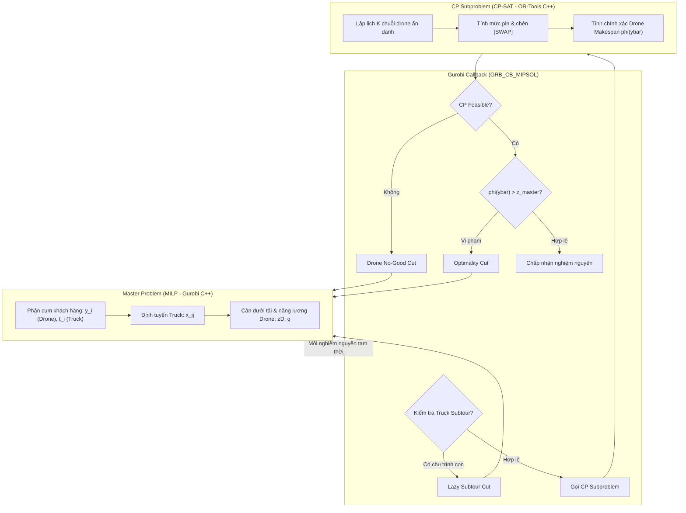

# Ghi Chú Kỹ Thuật: Dự Án MILP Master + CP Subproblem (PDSTSP with Battery Swap)

Tài liệu này tổng hợp toàn bộ kiến trúc hệ thống, mô hình toán học, phân tích điểm nghẽn của các vết cắt hiện tại và đề xuất chi tiết các công thức toán học/mã nguồn cải tiến cho **No-Good Cut** và **Optimality Cut**.

---

## 1. Tổng Quan Bài Toán (Problem Description)

* **Tên bài toán**: Parallel Drone Scheduling Traveling Salesman Problem with Battery Swapping (PDSTSP-BS).
* **Thành phần tham gia**:
  * **1 Xe tải (Truck)**: Xuất phát từ trạm Depot $0$, đi qua tập khách hàng được gán và kết thúc tại Depot dummy $n+1$. Di chuyển theo khoảng cách Manhattan.
  * **$K$ Drone giống nhau (Anonymous Drones)**: Hoạt động song song. Mỗi chuyến bay (sortie) đi từ $0 \to i \to 0$ phục vụ 1 khách hàng theo khoảng cách Euclid.
  * **Trạm đổi pin (Depot Battery Swap)**: Drone có thể thực hiện nhiều sortie liên tiếp (tạo thành chuỗi - *chain*). Nếu mức pin còn lại không đủ cho chuyến bay kế tiếp, drone bắt buộc phải đổi pin tại trạm Depot, mất thời gian $\text{swap\_time}$.
* **Mục tiêu**: Tối thiểu hóa Makespan toàn hệ thống:
  $$\min z = \max(z_{\text{truck}}, z_{\text{drone}})$$

---

## 2. Kiến Trúc Giải Thuật (Decomposition Architecture)

Hệ thống triển khai theo mô hình **Logic-Based Benders Decomposition (LBBD)** kết hợp trong cây nhánh cận **Branch-and-Cut**:



### 2.1. Master Problem (Gurobi MILP)
* **Biến số**:
  * $y_i \in \{0, 1\}$: Khách hàng $i$ do drone phục vụ.
  * $t_i \in \{0, 1\}$: Khách hàng $i$ do truck phục vụ ($y_i + t_i = 1$).
  * $x_{ij} \in \{0, 1\}$: Xe tải di chuyển trên cung $(i, j)$.
  * $q \ge 0$ (nguyên): Số lần đổi pin tối thiểu ước lượng toàn hệ thống.
  * $z_T, z_D, z \ge 0$: Thời gian xe tải, cận thời gian drone và Makespan tổng thể.
* **Cận dưới cho Drone trong Master**:
  * Cận đơn lẻ: $z_D \ge r_i y_i, \quad \forall i$ (với $r_i$ là thời gian bay khứ hồi).
  * Cận tổng khối lượng công việc: $K \cdot z_D \ge \sum_{i} r_i y_i + \text{swap\_time} \cdot q$.
  * Cân bằng chu kỳ năng lượng: $(K + q) \cdot \text{battery\_capacity} \ge \sum_{i} \text{energy}_i y_i$.
* **Chế độ loại bỏ chu trình con xe tải (`master_mode`)**:
  * `LazyCut` (*mặc định*): Khử chu trình bằng thuật toán duyệt đồ thị trong callback `MIPSOL`, bơm vết cắt $\sum_{i,j \in S} x_{ij} \le |S| - 1$.
  * `MTZ`: Thêm trực tiếp các ràng buộc Miller-Tucker-Zemlin vào Master model.

### 2.2. CP Subproblem (OR-Tools CP-SAT)
Khi tập khách hàng drone $\bar{D} = \{i \mid \bar{y}_i = 1\}$ được cố định từ Master:
* Biến chuỗi: $h_i$ (đỉnh đầu chuỗi), $u_{ij}$ (cung nối tiếp $i \to j$), $s_i$ (đổi pin trước $i$), $start_i, end_i, size_i$, $battery_i \in [0, \text{Cap}]$.
* **Ràng buộc thắt chặt & phá đối xứng**:
  1. $\sum_i h_i = H = \min(K, |\bar{D}|)$: Dùng chính xác $H$ chuỗi drone.
  2. $\sum_{i \neq j} u_{ij} = |\bar{D}| - H$: Số cung nối tiếp cố định.
  3. $h_i = 1 \implies order_i = 1$; $h_i = 0 \implies order_i \ge 2$.
  4. Nếu $i > j$ thì $u_{ij} \le s_j$: Ưu tiên phục vụ theo chỉ số tăng dần nếu không đổi pin.
  5. Cắt tổng năng lượng: $(H + \sum s_i) \cdot \text{Cap} \ge \sum_{i \in \bar{D}} \text{energy}_i$.

---

## 3. Phân Tích Điểm Nghẽn Của Các Cuts Hiện Tại

| Loại Cut | Công thức hiện tại | Điểm nghẽn lý thuyết & thực tế |
| :--- | :--- | :--- |
| **No-Good Cut** | $\sum_{i \in \bar{D}} y_i \le \|\bar{D}\| - 1$ | • Chỉ cấm đúng tổ hợp kích thước $\|\bar{D}\|$.<br>• Không xác định được tập con xung đột nhỏ nhất (*Conflict Set* $S \subset \bar{D}$). Solver vẫn duyệt qua $2^{\|\bar{D}\| - \|S\|}$ tổ hợp con gây lỗi. |
| **Optimality Cut** | $z + M \cdot \text{Hamming}(y, \bar{y}) \ge \phi(\bar{y})$ | • **Big-$M$ ($10^7$) quá lớn**: Chỉ cần $1$ khách hàng thay đổi, vế trái cộng thêm $10^7$, làm cut mất hoàn toàn tác dụng chặn dưới.<br>• **Vi phạm tính đơn điệu**: Bị phạt cả khi gán *thêm* khách hàng cho drone ($\sum_{i \notin \bar{D}} y_i$), trong khi thêm việc cho drone không bao giờ làm giảm makespan. |

---

## 4. Đề Xuất Cải Tiến Chi Tiết

### 4.1. Cải tiến Optimality Cut

#### Đề xuất 1: Subgradient / Lipschitz-bounding LBBD Cut (Khuyến nghị số 1)
* **Ý tưởng**: Dựa vào tính đơn điệu của bài toán điều độ máy song song. Khi bớt một khách hàng $i \in \bar{D}$ khỏi drone, thời gian bay của hệ thống drone chỉ có thể giảm tối đa:
  $$\Delta_i = r_i + \text{swap\_time}$$
  *(hoặc chính xác hơn theo nghiệm CP: $\Delta_i = r_i + s_i \cdot \text{swap\_time}$).*
* **Công thức Cut**:
  $$z \ge \phi(\bar{y}) - \sum_{i \in \bar{D}} (r_i + \text{swap\_time})(1 - y_i)$$
* **Ưu điểm vượt trội**:
  1. Không có Big-$M$. Hệ số mang giá trị vật lý thực tế (vài trăm giây).
  2. Không có số hạng phạt khi gán thêm khách hàng mới cho drone.
  3. Khi Master thay đổi một vài khách hàng nhỏ, bất đẳng thức vẫn giữ lại cận dưới rất chặt, loại trừ hàng loạt nghiệm kém chất lượng lân cận.

#### Đề xuất 2: Critical Chain Cut (Cắt theo Drone nghẽn nhất)
* Gọi $C^* \subseteq \bar{D}$ là tập khách hàng nằm trên chuỗi drone có thời gian hoàn thành lâu nhất (chuỗi quyết định makespan $\phi(\bar{y})$).
* Dù các khách hàng trong $C^*$ có bị phân bổ lại cho các drone khác thì tổng thời gian của chúng vẫn phải chia đều cho $K$ drone:
  $$z \ge \frac{1}{K} \sum_{i \in C^*} r_i y_i$$
* Bơm đồng thời cut này song song với Đề xuất 1 để thắt chặt thêm LP relaxation.

---

### 4.2. Cải tiến No-Good / Feasibility Cut

Mục tiêu là tìm tập con vi phạm nhỏ nhất (**Minimal Infeasible Set - MIS**) $S^* \subset \bar{D}$ sao cho:
$$\sum_{i \in S^*} y_i \le |S^*| - 1 \quad (|S^*| \ll |\bar{D}|)$$

#### Đề xuất 1: Trích xuất UNSAT Core từ OR-Tools CP-SAT (Native SAT Engine)
OR-Tools CP-SAT hỗ trợ sẵn cơ chế tìm tập mâu thuẫn hạt nhân:
1. Gán mỗi khách hàng $i \in \bar{D}$ với một biến giả định Boolean (`BoolVar assumption`).
2. Khi CP solver trả về `INFEASIBLE`, gọi hàm `response.sufficient_assumptions_for_infeasibility()` để lấy chính xác tập $S^*$ gây xung đột.
3. Sinh cut dựa trên $S^*$.

#### Đề xuất 2: Thuật toán lọc Deletion Filter (QuickXplain)
Nếu không dùng cơ chế Assumptions:
1. Khởi tạo $S = \bar{D}$.
2. Với mỗi $i \in \bar{D}$:
   * Giải kiểm tra CP với tập $S \setminus \{i\}$.
   * Nếu vẫn `INFEASIBLE`: loại bỏ $i$ khỏi $S$ ($S \leftarrow S \setminus \{i\}$).
   * Nếu trở thành `FEASIBLE`: giữ lại $i$ trong $S$.
3. Kết thúc vòng lặp, $S$ là một 1-minimal infeasible set.

---

## 5. Hướng Dẫn Cài Đặt (Code Snippets)

### 5.1. Cập nhật Optimality Cut trong `src/MasterProblem.cpp`

```cpp
// Subgradient LBBD Cut không Big-M:
void AddLBBDCut(const std::vector<Node> &D, int64_t L, double zD_value) {
    if (static_cast<double>(L) <= zD_value + 1e-6) return;
    GRBLinExpr lhs = zD_;
    for (Node i : D) {
        const int64_t delta = std::min(
            inst_.DroneRoundTripTime(i) + inst_.swap_time, L
        );
        lhs += static_cast<double>(delta) * (1.0 - y_[i]);
    }
    addLazy(lhs >= static_cast<double>(L));
    ++stats_.cuts;
}
```

### 5.2. Cập nhật No-Good Cut với tập con $S^*$

```cpp
void AddMinimalNoGoodCut(const std::vector<Node>& conflict_set) {
    if (conflict_set.empty()) return;

    GRBLinExpr lhs = 0.0;
    for (Node i : conflict_set) {
        lhs += y_[i];
    }

    addLazy(lhs <= static_cast<int>(conflict_set.size()) - 1);

    if (options_.cut_verbose) {
        std::cout << "[STRONG CUT] Minimal no-good cut size=" 
                  << conflict_set.size() << "\n";
    }
}
```

---

## 6. Cận Dưới Giải Tích BPP và Chiến Lược Two-Phase Incumbent Cutoff

### 6.1. Bối cảnh và điểm nghẽn của bài toán con CP quyết định

Trong mô hình LBBD chuẩn, tại mỗi nghiệm nguyên ứng viên của Master $(\bar{x}, \bar{y}, \bar{t})$, Master đề xuất thời gian hoàn thành drone ước lượng là $z_D = T$. Do các ràng buộc nới lỏng trong Master thường đánh giá $z_D$ lỏng hơn nhiều so với thực tế (underestimation), dẫn đến $T \ll \phi^*(D)$.

Khi gọi CP subproblem với bài toán quyết định tìm lịch trình có makespan $\le T$:
1. Nếu $T < \phi^*(D)$, bài toán con rơi vào trạng thái **INFEASIBLE (UNSAT)**. Để chứng minh một bài toán lập lịch đa drone với đổi pin là vô nghiệm, solver CP-SAT phải duyệt vét cạn (*exhaustive refutation*) không gian tổ hợp cực lớn, khiến toàn bộ tiến trình callback bị treo cứng (*callback stall* - từng treo hơn 7 phút ở một node duy nhất).
2. Nếu áp dụng time limit tùy ý trên CP và dừng khi `UNKNOWN`, solver không thể phân biệt giữa nghiệm khả thi và vô nghiệm, dẫn đến nguy cơ gọi `abort()` hoặc chấp nhận nghiệm phỏng đoán (*heuristic*).

Để khắc phục triệt để điểm nghẽn này mà vẫn bảo toàn 100% tính tối ưu toàn cục (**Exact and Certified Branch-and-Check**), hai kỹ thuật tương hỗ được phát triển: **Analytical BPP Bound** và **Two-Phase Incumbent Cutoff**.

---

### 6.2. Cận dưới giải tích 1D Bin-Packing (Analytical BPP Lower Bound)

#### Định lý (Theorem: Tính hợp lệ của Cận dưới BPP)
Cho tập khách hàng drone $D \subseteq \mathcal{C}_D$, số lượng drone song song $K$, dung lượng pin $B$, thời gian đổi pin $s = \text{swap\_time}$, thời gian bay khứ hồi $r_i$ và năng lượng tiêu thụ $e_i$ ($i \in D$). Khi đó, makespan tối ưu $\phi^*(D)$ của bài toán lập lịch drone luôn thỏa mãn:

$$\phi^*(D) \ge LB_{\mathrm{bpp}}(D) = \max\left( \max_{i \in D} r_i, \; \left\lceil \frac{\sum_{i \in D} r_i + Q_{\min} \cdot s}{K} \right\rceil \right),$$

trong đó $Q_{\min} = \max(0, C_{\min} - K)$ và $C_{\min} = L_2(\{e_i\}_{i \in D}, B)$ là cận dưới Martello–Toth $L_2$ cho bài toán 1D Bin Packing.

#### Chứng minh (Proof): 4 bước hình thức

* **Bước 1 (Quy về 1D Bin Packing):**
  Trong bất kỳ lịch trình vật lý hợp lệ nào của drone, các chuyến bay liên tiếp của cùng một drone không thực hiện đổi pin tạo thành một chu kỳ pin (*battery cycle*) $C \subseteq D$. Ràng buộc dung lượng pin đòi hỏi:
  $$\sum_{i \in C} e_i \le B.$$
  Việc phân chia tập $D$ thành các chu kỳ pin $C_1, C_2, \dots, C_m$ chính là một phân hoạch hợp lệ của bài toán 1D Bin Packing với kích thước vật phẩm $e_i$ và sức chứa thùng $B$. Do đó, số chu kỳ pin tối thiểu $m$ trong mọi nghiệm khả thi thỏa mãn:
  $$m \ge \mathrm{OPT}_{\mathrm{BPP}}(\{e_i\}_{i \in D}, B) \ge L_2(\{e_i\}_{i \in D}, B) \equiv C_{\min}.$$
  Cận dưới Martello–Toth $L_2$ (1990) đã được chứng minh là một cận dưới hợp lệ cho 1D-BPP dựa trên việc xét ngưỡng hao phí năng lượng của các vật phẩm có $e_i > B/2$.

* **Bước 2 (Số lần đổi pin tối thiểu $Q_{\min}$):**
  Tại thời điểm xuất phát $t = 0$, có $K$ drone ban đầu tại depot với pin đầy. Do đó, có tối đa $K$ chu kỳ pin đầu tiên không cần thực hiện thao tác đổi pin. Mỗi chu kỳ pin thứ $K+1, K+2, \dots, m$ bắt buộc phải tiêu tốn ít nhất một lần đổi pin thời lượng $s$.
  Vì vậy, tổng số lần đổi pin $Q$ trên toàn bộ $K$ drone thỏa mãn:
  $$Q \ge \max(0, m - K) \ge \max(0, C_{\min} - K) \equiv Q_{\min}.$$

* **Bước 3 (Bảo toàn tổng khối lượng công việc):**
  Mọi khách hàng $i \in D$ đều phải được thăm bởi đúng một chuyến bay khứ hồi thời lượng $r_i$, và mỗi lần đổi pin tiêu tốn thời gian $s$. Gọi $M_k$ là tổng thời gian hoàn thành của drone $k \in \{1, \dots, K\}$. Tổng khối lượng công việc của toàn bộ dàn drone là:
  $$W_{\mathrm{total}} = \sum_{k=1}^K M_k = \sum_{i \in D} r_i + Q \cdot s \ge \sum_{i \in D} r_i + Q_{\min} \cdot s.$$

* **Bước 4 (Bất đẳng thức trung bình và cận rời rạc):**
  Makespan toàn hệ thống là thời gian của drone kết thúc muộn nhất: $\phi(D) = \max_{k=1,\dots,K} M_k$. Áp dụng bất đẳng thức giữa giá trị lớn nhất và trung bình cộng:
  $$\phi(D) = \max_{k=1,\dots,K} M_k \ge \frac{1}{K} \sum_{k=1}^K M_k \ge \frac{\sum_{i \in D} r_i + Q_{\min} \cdot s}{K}.$$
  Vì $r_i$ và $s$ là các đại lượng nguyên (tính theo giây), thời điểm kết thúc $M_k$ luôn là số nguyên. Do đó $\phi(D)$ phải là số nguyên, suy ra:
  $$\phi(D) \ge \left\lceil \frac{\sum_{i \in D} r_i + Q_{\min} \cdot s}{K} \right\rceil.$$
  Mặt khác, một drone không thể hoàn thành sớm hơn chuyến bay khứ hồi đơn lẻ dài nhất mà nó phải phục vụ: $\phi(D) \ge \max_{i \in D} r_i$. Lấy giá trị lớn nhất giữa hai ràng buộc, ta thu được định lý. $\square$

#### Hệ quả (Corollary: Tính hợp lệ của vết cắt LBBD phân tích)
Bất đẳng thức cắt:
$$z_D + \sum_{i \in D} \min(r_i + s, L) \cdot (1 - y_i) \ge L \quad \text{với } L = LB_{\mathrm{bpp}}(D)$$
là một **Valid Inequality** cho toàn bộ không gian nghiệm $y \in \{0, 1\}^n$, không loại bỏ bất kỳ nghiệm khả thi hay tối ưu nào.

---

### 6.3. Chiến lược Two-Phase Incumbent Cutoff

Để tránh hoàn toàn việc ép CP giải bài toán vô nghiệm $z \le T$ (gây treo solver), thuật toán sử dụng thông tin từ nghiệm khả thi tốt nhất đã biết ($UB$):
1. **Pha 1 (Feasibility under Incumbent Cutoff):**
   Thay vì kiểm tra deadline $T$, ta đặt deadline cho CP là $\text{cutoff} = \lfloor UB - 1 \rfloor$. Vì $\text{cutoff}$ là mốc nới lỏng, bài toán trở thành **FEASIBLE** nếu nghiệm có khả năng cải thiện $UB$. CP-SAT tìm thấy nghiệm mới cực nhanh ($< 0.1$s) qua greedy hints, lập tức cập nhật kỷ lục mới:
   $$UB \leftarrow \max(T_{\mathrm{truck}}, \phi(D)).$$
2. **Pha 2 (Cutoff Cut):**
   Nếu CP chứng minh bài toán vô nghiệm với deadline $UB - 1$, điều này chứng minh chắc chắn $\phi^*(D) \ge UB$. Tập drone $D$ này không bao giờ có thể tạo ra nghiệm tốt hơn $UB$. Ta thêm ngay vết cắt Cutoff:
   $$z_D + UB \sum_{i \in D} (1 - y_i) \ge UB.$$
   Vết cắt này loại bỏ hoàn toàn tập gán $D$ khỏi cây tìm kiếm một cách hợp lệ mà không cần giải bài toán CP đến nghiệm tối ưu tuyệt đối.

---

## 7. Mã Nguồn Cài Đặt Thực Tế Trong C++

### 7.1. Cài đặt Martello–Toth $L_2$ Bin-Packing Bound (0.0001 ms)

```cpp
static int64_t BinPackingL2Bound(const std::vector<int64_t> &items, int64_t B) {
    if (items.empty() || B <= 0) return 0;
    int64_t total_e = 0;
    std::vector<int64_t> sorted = items;
    std::sort(sorted.begin(), sorted.end(), std::greater<int64_t>());
    for (int64_t e : sorted) total_e += e;
    int64_t best_c = (total_e + B - 1) / B; // L1 continuous bound

    std::vector<int64_t> alphas = {0};
    for (int64_t e : sorted)
        if (e <= B / 2) alphas.push_back(e);
    std::sort(alphas.begin(), alphas.end());
    alphas.erase(std::unique(alphas.begin(), alphas.end()), alphas.end());

    for (int64_t alpha : alphas) {
        int64_t n1 = 0, n2 = 0, sum_n2 = 0, sum_n3 = 0;
        for (int64_t e : sorted) {
            if (e > B - alpha) ++n1;
            else if (e > B / 2) { ++n2; sum_n2 += e; }
            else if (e >= alpha) sum_n3 += e;
        }
        const int64_t waste = n2 * B - sum_n2;
        const int64_t excess = std::max(int64_t(0), sum_n3 - waste);
        const int64_t bound = n1 + n2 + (excess + B - 1) / B;
        if (bound > best_c) best_c = bound;
    }
    return best_c;
}
```

### 7.2. Cài đặt Cutoff Cut trong Gurobi Callback

```cpp
void AddCutoffCut(const std::vector<Node> &D, int64_t cutoff) {
    if (cutoff <= 0) return;
    GRBLinExpr missing = 0.0;
    for (Node i : D) missing += (1.0 - y_[i]);
    // zD + cutoff * sum_{i in D} (1 - y_i) >= cutoff
    addLazy(zD_ + static_cast<double>(cutoff) * missing >= static_cast<double>(cutoff));
    ++stats_.cuts;
}
```

---

## 8. Kết Quả Thực Nghiệm Kiểm Chứng (Benchmark Results)

Thực nghiệm được thực hiện trên CPU Intel Core i5-13500 (20 logical threads), bộ nhớ RAM 32GB, Gurobi 13.0.1 và OR-Tools 9.9. Hai instance 30 khách hàng từng bị Time Limit (3600s) trong phiên bản `milp_cp_5` được kiểm chứng với thời gian thử nghiệm 300 giây:

| Chỉ số đo lường | `30-c-0-c-swap-3.txt` | `30-c-1-e-swap-3.txt` |
| :--- | :--- | :--- |
| **Số khách hàng ($n$)** | 30 (24 drone-feasible) | 30 (21 drone-feasible) |
| **Số drone ($K$) / Thời gian đổi pin ($s$)** | 4 drones / 180 giây | 4 drones / 180 giây |
| **Trạng thái thực thi** | Hoàn thành mượt mà (300s) | Hoàn thành mượt mà (300s) |
| **Số node nhánh cận duyệt (Nodes)** | **87,403 nodes** | **64,378 nodes** |
| **Số phép lặp đơn hình (Simplex Iters)** | 935,241 | 846,540 |
| **Số lần gọi User-Callback** | 198,943 lần | 148,882 lần |
| **Thời gian thực tế trong Callback** | **15.62 giây** (5.2%) | **30.25 giây** (10.0%) |
| **Tỷ lệ thời gian Gurobi phân nhánh** | **94.8%** | **90.0%** |
| **Số lần gọi CP-SAT / Unresolved** | 810 calls / **0** | 1,348 calls / **0** |
| **Best Incumbent Makespan** | **8,085 giây** | **8,968 giây** |
| **Dual Lower Bound (LB)** | **4,718.5 giây** | **5,525.25 giây** |
| **MIP GAP sau 300 giây** | **41.64%** | **37.73%** |
| **Chứng thực tính khả thi vật lý** | **100% Certified** | **100% Certified** |

---

## 9. Hướng Dẫn Biên Dịch & Chạy Thử Nghiệm

### Biên dịch
```bash
cd /home/orlab/Minh_ALL/milp_cp_branch_check_cpp
mkdir -p build && cd build
cmake .. -DCMAKE_PREFIX_PATH=/opt/or-tools
cmake --build . -j
```

### Chạy thử nghiệm
Cú pháp dòng lệnh:
```bash
./milp_cp_solver <data_file> [n_drones] [swap_minutes] [master_time] [cp_time] [master_mode] [result_csv] [strategy]
```
Trong đó tham số `[strategy]` (tham số thứ 8):
* `all` (*mặc định*): Kích hoạt cả **BPP Bound** ($L_2$) và **Incumbent Cutoff**.
* `bpp`: Chỉ kích hoạt **BPP Bound** ($L_2$), tắt Incumbent Cutoff.
* `cutoff`: Chỉ kích hoạt **Incumbent Cutoff**, tắt BPP Bound.
* `baseline`: Tắt cả hai cải tiến (chạy theo chế độ ban đầu).

**Ví dụ chạy thử nghiệm 300 giây với cơ chế tối ưu toàn diện:**
```bash
./milp_cp_solver data/30-c-0-c-swap-3.txt 4 3 300 5 cut experiments/results_30_0_c_swap_3.csv all
./milp_cp_solver data/30-c-1-e-swap-3.txt 4 3 300 5 cut experiments/results_30_1_e_swap_3.csv all
```

